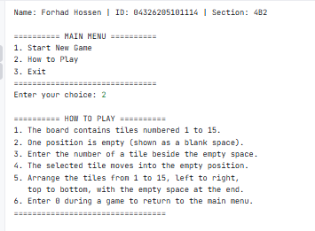
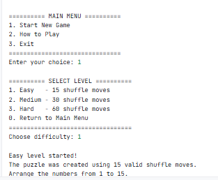
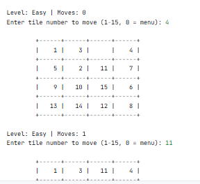
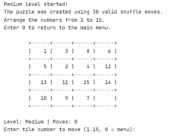

# Number Slide Puzzle | C++

A classic **15-Puzzle Game** built using C++ and Object-Oriented Programming (OOP). Challenge yourself to arrange numbered tiles in the correct order by moving them into the empty space.

The game runs in the terminal and offers three difficulty levels, randomized puzzle generation, move tracking, and completion-time calculation.

## Project Screenshots

## 📸 Project Screenshots

### Main Menu


### How to Play


### Easy Level


### Medium Level

## Features

- **Interactive Main Menu** – Start a new game, view instructions, or exit.
- **Three Difficulty Levels** – Choose Easy, Medium, or Hard.
- **Randomized Puzzle Generation** – Generate puzzles through valid tile movements from the solved board.
- **Solvable Puzzle States** – Shuffling through legal moves ensures the generated board remains solvable.
- **Interactive Gameplay** – Move a tile by entering its number.
- **Move Counter** – Track the total number of successful moves.
- **Game Timer** – Calculate how long it takes to solve the puzzle.
- **Input Validation** – Handle invalid inputs and prevent illegal tile movements.
- **Return to Main Menu** – Exit an active game without closing the application.

## Difficulty Levels

| Level | Shuffle Moves |
|---|---:|
| Easy | 15 |
| Medium | 30 |
| Hard | 60 |

## How to Play

1. Start the game.
2. Select your preferred difficulty level.
3. A 4×4 puzzle board containing tiles numbered 1–15 will appear.
4. One position on the board will remain empty.
5. Enter the number of a tile adjacent to the empty position.
6. The selected tile moves into the empty space.
7. Arrange all tiles in ascending order, from 1 to 15, with the empty position at the bottom-right corner.
8. Solve the puzzle to see your total moves and completion time.

**Tip:** Enter `0` during gameplay to return to the main menu.

## Technologies Used

- **Programming Language:** C++
- **Core Concepts:** Object-Oriented Programming (OOP)
- **Standard Libraries:** iostream, array, algorithm, chrono, random, vector, string, iomanip, limits, and utility.
- **Random Number Generation:** Mersenne Twister (`mt19937`)
- **Development Environment:** Any C++ compiler supporting C++11 or later.

##  Getting Started

### Prerequisites

You need a C++ compiler installed on your computer.

Recommended:
- GCC / G++
- MinGW (Windows)
- Visual Studio (with C++ support)

### Installation

**1. Clone the repository**

```bash
git clone https://github.com/YOUR-USERNAME/number-slide-puzzle.git
```

**2. Open the project directory**

```bash
cd number-slide-puzzle
```

**3. Compile the source code**

Using GCC or MinGW:

```bash
g++ -std=c++11 NumberSlidePuzzle.cpp -o puzzle
```

**4. Run the game**

On Windows:

```bash
puzzle.exe
```

On Linux or macOS:

```bash
./puzzle
```

## What I Learned

Through this project, I practiced:

- Applying Object-Oriented Programming concepts in C++.
- Working with 2D arrays to represent a puzzle board.
- Using functions to organize program logic.
- Implementing randomization with the C++ random library.
- Handling user input and invalid operations.
- Using conditional statements and loops for interactive gameplay.
- Tracking execution time using the chrono library.
- Implementing puzzle-shuffling logic while maintaining solvability.

## Project Structure

```text
number-slide-puzzle/
│
├── screenshots/
│   ├── main-menu.png
│   ├── how-to-play.png
│   ├── easy-level.png
│   └── medium-level.png
│
├── NumberSlidePuzzle.cpp
├── README.md
└── .gitignore
```

##  Future Improvements

Some ideas for future versions:

- Add a graphical user interface (GUI).
- Add a leaderboard and high-score system.
- Save game progress and allow users to resume.
- Add sound effects and animations.
- Implement a smarter puzzle-solving hint system.

##  Author

**Forhad Hossen**

C++ Programming Project

---

⭐ If you find this project interesting, consider giving the repository a star!

**Thank you for checking out Number Slide Puzzle!**
